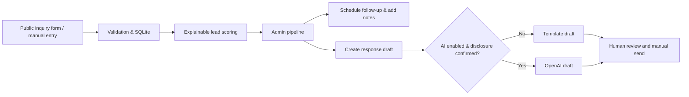

# SPM AI Sales Agent

**A working, local-first sales CRM and AI-assisted follow-up demo for SPManchester Private Limited.**

> **Portfolio transparency:** This repository is an independently developed demonstration project for the SPManchester portfolio. It is **not** evidence of a commissioned client engagement or a production deployment. All included sample business names and contacts are fictional. Do not upload real customer records to a public repository.

**Status:** Functional prototype / portfolio demonstration  
**Company:** [SPManchester Private Limited](https://spmanchester.com)  
**Repository suggestion:** `spm-ai-sales-agent`  
**License:** MIT (see `LICENSE`)  
**Stack:** Python 3.11+, FastAPI, SQLite, vanilla HTML/CSS/JavaScript, optional OpenAI Responses API

## Why this exists

Small agencies, call centres and service businesses often lose opportunities between the initial inquiry and the follow-up. This demo provides a straightforward place to capture requests, assess priority and generate a draft response—with a human in control.

## Implemented features

- **Password-protected admin dashboard** with per-session CSRF token and basic login rate limiting.
- **Public inquiry form** at `/capture` with a honeypot, throttling, input validation and consent checkbox.
- **Lead pipeline** with six statuses: new, contacted, qualified, proposal, won and lost.
- **Explainable lead scoring** from budget, timeline, service fit and source; hot/warm/cold labels.
- **Follow-up scheduling** and overdue follow-up KPI (the app does not send reminders).
- **Manual activity notes**, contact details, filters, search, pagination, deletion and safe CSV export.
- **One-click template drafts** that work offline, plus **optional real AI drafts** with a separately supplied API key and explicit disclosure confirmation.
- **Responsive custom-designed UI**, fictional sample-data script, automated tests and Docker support.

**Not implemented:** automatic email/WhatsApp dispatch, integrations with Meta/Google/HubSpot, multi-tenant isolation, a background job scheduler, SSO, advanced auditing or production-grade protection against distributed abuse. These are future opportunities, not features to advertise as complete.

## Quick start (Windows)

1. Install **Python 3.11 or later** from [python.org](https://www.python.org/downloads/). Enable *Add Python to PATH*.
2. Download this project, extract it and open the project folder.
3. Double-click **`start.bat`**. It creates a virtual environment, installs dependencies and creates a unique admin password in `.env` on first run.
4. Save the password printed in the console. Open **http://127.0.0.1:8000** and log in.
5. Optional: from a second terminal, run `\.venv\Scripts\python.exe scripts\seed_demo.py` to add six entirely fictional records. Refresh the dashboard.

### macOS / Linux

```bash
chmod +x start.sh
./start.sh
# Optional, in a second terminal:
.venv/bin/python scripts/seed_demo.py
```

### Manual / developer setup

```bash
python -m venv .venv
# macOS/Linux: source .venv/bin/activate
# Windows PowerShell: .venv\Scripts\Activate.ps1
python -m pip install -r requirements-dev.txt
python scripts/bootstrap.py
python scripts/seed_demo.py        # optional fictional data only
python -m uvicorn app.main:app --reload --host 127.0.0.1 --port 8000
python -m pytest -q
```

The full getting-started guide is in **[`docs/QUICKSTART.md`](docs/QUICKSTART.md)**.

## User flow



## Working demo navigation

| Page / route | Purpose |
| --- | --- |
| `/` | Admin dashboard and password login |
| `/capture` | Public inquiry form (demo; enabled by default) |
| `/docs` | Interactive OpenAPI / Swagger API reference |
| `/api/health` | Basic application health JSON |

## Optional AI integration

1. After bootstrap, edit your **local** `.env` file.
2. Set `OPENAI_API_KEY=...` and optionally change `OPENAI_MODEL` to a model available on your account.
3. Restart the app. Open a lead, select **Generate with AI** and explicitly approve limited external processing.

The app sends **company name, service, indicative budget and timeline** to the configured provider. It intentionally excludes the lead's name, email, phone and free-form message. API usage may be chargeable. A user must review all drafts before sending; the demo **never sends emails or WhatsApp messages automatically**. Without a key, **Generate template** still works locally.

**Never commit the `.env` file, credentials, or customer data to GitHub.** `data/` is already git-ignored.

## Engineering reference

- [Product requirements](docs/PRD.md)
- [Technical requirements](docs/TRD.md)
- [Architecture](docs/ARCHITECTURE.md)
- [REST API reference](docs/API.md)
- [Database dictionary](docs/DATABASE.md)
- [User guide](docs/USER_GUIDE.md)
- [Security and privacy limitations](docs/SECURITY.md)
- [Local / Docker deployment](docs/DEPLOYMENT.md)
- [Test plan](docs/TEST_PLAN.md)
- [Future roadmap](docs/ROADMAP.md)
- [GitHub portfolio publishing checklist](docs/GITHUB_PUBLISHING.md)
- [Contributing](CONTRIBUTING.md)

## Project structure

```text
spm-ai-sales-agent/
├── app/
│   ├── main.py             # FastAPI app, auth, CRM endpoints
│   ├── database.py         # SQLite tables and database helpers
│   ├── scoring.py          # Explainable, deterministic lead scoring
│   ├── ai.py               # Template drafting + optional external AI
│   ├── config.py           # Environment settings
│   └── static/
│       ├── index.html      # Admin dashboard
│       ├── app.js          # Dashboard interactions
│       ├── styles.css      # Responsive styles
│       ├── capture.html    # Public inquiry form
│       └── capture.js
├── docs/                   # Requirements, architecture, API, guides
├── scripts/
│   ├── bootstrap.py        # Secure local admin credential creation
│   └── seed_demo.py        # Fictional data only
├── tests/                  # Pytest API/unit tests
├── .github/workflows/ci.yml
├── .env.example            # Template only; never secrets
├── start.bat / start.sh
├── requirements.txt / requirements-dev.txt
├── Dockerfile / compose.yaml
└── LICENSE
```

## Screenshots and portfolio honesty

To get genuine screenshots, start the application and add the included fictional seed data. Screenshot your **actual running** dashboard and put the images under `docs/screenshots/` if useful. No made-up testimonials, fake customer logos, or invented project results are supplied.

## Support and boundaries

This repository is an engineering showcase, not a ready-to-sell multi-tenant SaaS. For public internet exposure, carry out the production hardening steps in `docs/SECURITY.md` and `docs/DEPLOYMENT.md`. Do not use real personal data unless you have a valid legal basis and appropriate controls.
