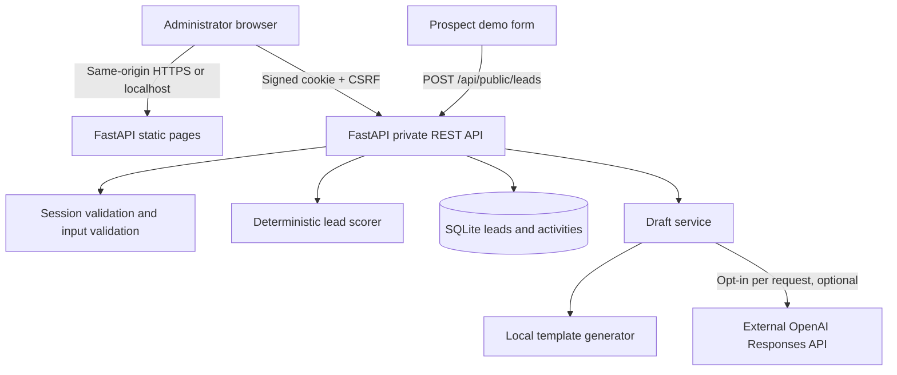
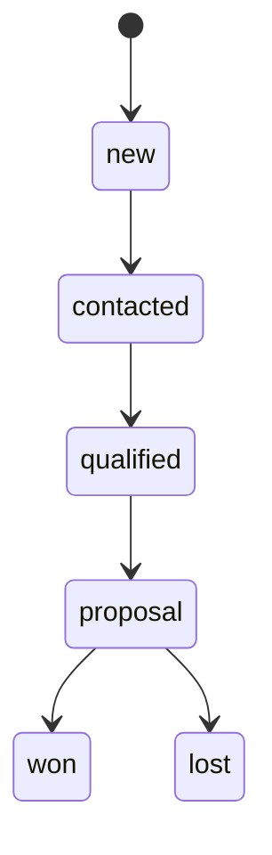

# System architecture

## Component diagram

## Source boundaries
- `app/main.py`: API routes, session management, validation, CSV export.
- `app/scoring.py`: pure, deterministic lead qualification.
- `app/database.py`: SQL schema and connection context helper.
- `app/ai.py`: local draft formatter and isolated optional external API call.
- `app/config.py`: runtime environment variables.
- `app/static/*`: frontend and browser-side form behavior.

## Trust boundaries
1. Browser requests are untrusted; validate with Pydantic and authenticate private routes.
2. SQLite receives values through parameterized statements, never through string concatenation for untrusted values.
3. AI prompt context is untrusted. Provider instructions require factual, no-invention drafts, but a human must still check responses.
4. `.env` and `data/` are local secrets/data; they must not be published.

## Offline behavior
All major CRUD, filtering, scoring, exports and template drafting work without a connected AI service once Python dependencies are installed. Generative AI drafts require an active API key and Internet connection.

## State transitions
Pipeline states are selectable in any order in this demo. Production workflows may enforce transitions and role permissions.

## Database evolution
`initialize()` creates tables if absent. There is **no schema migration framework**; add Alembic or similar before introducing breaking production changes. Copy and back up the SQLite file when doing exploratory schema work.
